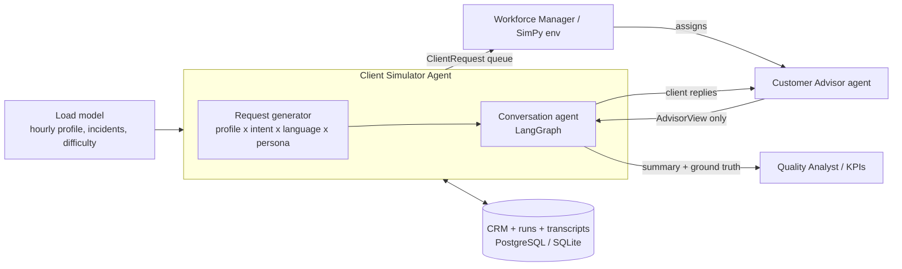
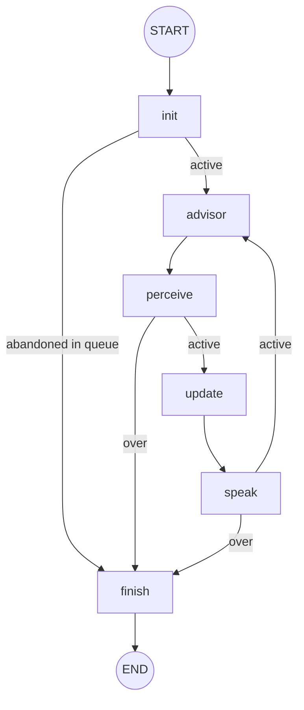
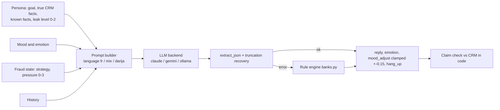

# Client Simulator Agent: architecture

## 1. Place in the multi-agent system

The advisor never sees the hidden state: only `AdvisorView` (history, caller id, `crm_lookup`).

## 2. The LangGraph agent (graph.py), one call

| Node | Kind | Does |
|---|---|---|
| init | code | `sim.start`: queue wait lowers mood, abandon if patience exceeded, opening message |
| advisor | external | any `AdvisorView -> str` (scripted, `llm_advisor`, a human, another graph) |
| perceive | **LLM judge** (rules fallback) | reads the advisor message: empathy, identity check, secret-code request, refusal, resolution, escalation, tone |
| update | code | mood, fraud pressure and strategy switch, end-of-call rules (resolved / escalated / hung up / max turns) |
| speak | **LLM client** (rules fallback) | writes the next line from hidden goal, persona, emotion; fraudster uses only the facts it really knows; then identity claims are checked against the CRM **in code** |
| finish | code | `summary()`: status, satisfaction, `is_fraudster`, `identity_verified`, `mood_trace`, `engine`, `llm_error` |

State (`CallState`): `conv` (hidden ground truth), `advisor_msg`, `features`, `summary`, `trace`.

## 3. Inside the client's brain

Safety nets: JSON extraction tolerates fences and comments and recovers a cut-off reply; any failure is
recorded in `st.llm_error` and `sim.llm_errors` (shown in the UI), never silent; `llm_strict=True` raises.

## 4. Layers
| Layer | Files |
|---|---|
| Agent orchestration | `graph.py` (LangGraph, with a built-in runner if the package is missing) |
| Agent logic | `client_simulator.py` (`perceive` / `update` / `speak`), `persona.py`, `judge.py`, `banks.py` |
| LLM access | `llm_backends.py` (.env loading, `auto_llm`, `check_llm`, JSON helpers) |
| Environment | `load_model.py`, `sim_env.py` (SimPy: queue, advisors, KPIs), `advisors.py` |
| Storage | `db.py` (PostgreSQL / SQLite: CRM, runs, calls, turns, KPIs) |
| Interfaces | `api.py` (FastAPI, `/api/llm/status`), `frontend/` (Next.js), `audio.py` |
